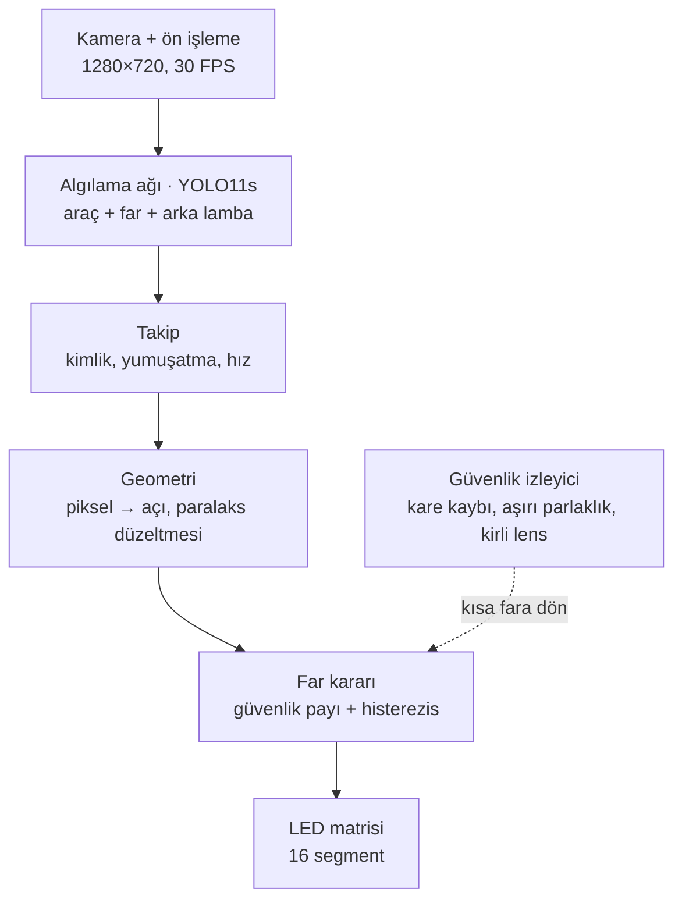

# ADB Night Perception

**Gece sürüşü için kamera tabanlı adaptif uzun far (ADB) algılama sistemi.** Tek ön kameradan araçları, farları ve arka lambaları algılar. Uzun farı açık tutarken yalnızca diğer yol kullanıcılarının bulunduğu açı dilimlerini karartacak 16 segmentlik bir far maskesi üretir. Hedef platform: gömülü cihaz (NVIDIA Jetson) üzerinde gerçek zamanlı çalışma.

> **Durum:** Faz 4 / 6 tamamlandı, Faz 5 (gerçek zamanlılık) sürüyor: TensorRT FP16 ile tam kare + ufuk bandı algılaması RTX 5050'de **~11 ms** (Deney 9), doğruluk PyTorch ile aynı (Deney 10). Python hattının tamamı bant iki karede bir ile p95 **39 ms** (hedef ≤ 50 ms); darboğaz ön/son işleme, C++ hattıyla çözülecek. Araç sınıfında gece mAP50 **0,79**. Gece 220 m bandında araç veya ışığı tam kare çıkarımla **%75**, ufuk bandı dilimlemesiyle **%85** yakalanıyor (hedef %90). Otoyol gece videolarında far titremesi dakikada **1,2** (hedef ≤ 2). Lambası yanan araçlarda kamaşma ihlali **%1,3** (hedef ≤ %1): ihlallerin hiçbiri far geometrisinden değil, 4/5'i bozuk görüntülerden (ıslak cam, kamera sarsıntısı). Ayrıntılar: [docs/results.md](docs/results.md) · Süreç, sorunlar ve çözümler: [docs/devlog.md](docs/devlog.md)

---

## İçindekiler
1. [Problem](#problem)
2. [Sistem mimarisi](#sistem-mimarisi)
3. [Sonuçlar](#sonuçlar)
4. [Veri ve etiketleme](#veri-ve-etiketleme)
5. [Model ve eğitim](#model-ve-eğitim)
6. [Kurulum ve kullanım](#kurulum-ve-kullanım)
7. [Repo yapısı](#repo-yapısı)
8. [Mühendislik dokümanları](#mühendislik-dokümanları)
9. [Yol haritası](#yol-haritası)
10. [Bilinen sınırlamalar](#bilinen-sınırlamalar)
11. [Lisans](#lisans)

---

## Problem

Uzun far görüş mesafesini yaklaşık iki katına çıkarır, ama diğer sürücüleri kamaştırdığı için az kullanılır. ADB sistemi uzun farı açık tutar ve yalnızca diğer araçların bulunduğu dilimleri karartır. Bunun için sistemin araçları **çok uzaktan ve gece** fark etmesi gerekir.

Asıl zorluk mesafe. 60° görüş açılı, 1280 px genişliğinde bir kamerada:

| Mesafe | Far çifti arası (1,5 m) | Tek far/lamba (0,2 m) |
|---|---|---|
| 30 m | 55 px | 7 px |
| 100 m | 17 px | 2 px |
| **220 m** | **8 px** | **1 px** |

ABD'deki ADB kuralı (FMVSS 108) karşıdan gelen araçları 220 m'ye kadar test ediyor. Bu mesafede araç gövdesi gece görünmez, sadece **8 piksel aralıklı iki ışık noktası** kalır. Bu yüzden sistem araç gövdesinin yanında far ve arka lambaları da ayrı sınıflar olarak algılıyor. Hesap: [`scripts/pixel_budget.py`](scripts/pixel_budget.py), gerekçeler: [docs/requirements.md](docs/requirements.md).

## Sistem mimarisi



| Modül | Durum | Not |
|---|---|---|
| Algılama | ✅ eğitildi | YOLO11s, 1280 px, 10 sınıf |
| Ufuk bandı dilimleme | ✅ kod + birim test | Uzak araçlar için 2x büyütülmüş bant parçaları ([`adb/slicing.py`](adb/slicing.py)) |
| Geometri | ✅ kod + birim test | Paralaks düzeltmesi zorunlu: 15 m'de 3,7° hata (~2 segment) |
| Takip | ✅ kod + birim test | Uzak/küçük nesnelere uyarlanmış ByteTrack mantığı ([`adb/tracking.py`](adb/tracking.py)) |
| Far kararı | ✅ kod + birim test | Paralaks düzeltmesi, güvenlik payı, histerezis ([`adb/decision.py`](adb/decision.py)) |
| Güvenlik izleyici | ✅ kod + birim test | Kare gecikmesi ve aşırı parlaklıkta kısa fara dönüş. Bulanıklık kontrolü kapalı, güvenilir eşik bulunamadı ([`adb/safety.py`](adb/safety.py), ADR-018) |
| Gömülü dağıtım | 🔄 Faz 5 | TensorRT FP16 motorları ✅ (tam kare 736×1280 + bant 4×704×768, [ADR-019](docs/decisions.md)), doğruluk eşitliği ✅, FP16 seçildi ([ADR-020](docs/decisions.md)), C++ ⏳ ([deploy/](deploy/README.md)) |

## Sonuçlar

**Deney 1: Temel model.** Test seti: BDD100K val (10.000 görüntü), koşullara ayrılmış.

| Koşul | Görüntü | Precision | Recall | mAP50 | car | truck | motorcycle | person |
|---|---|---|---|---|---|---|---|---|
| Gündüz | 4.435 | 0,70 | 0,54 | 0,61 | 0,84 | 0,62 | 0,40 | 0,69 |
| **Gece** | 3.363 | 0,66 | 0,54 | 0,59 | **0,79** | 0,59 | 0,44 | 0,64 |
| Yağmurlu gece | 566 | 0,63 | 0,53 | 0,59 | 0,79 | 0,62 | 0,46 | 0,62 |
| Alacakaranlık | 648 | 0,77 | 0,53 | 0,62 | 0,84 | 0,62 | 0,41 | 0,65 |

**Hız:** RTX 5050 Laptop, FP16, 1280 px'te görüntü başına 6,5 ms çıkarım.

**Gözlemler:**
- **Gece–gündüz farkı küçük:** Genel mAP50'de 1,6 puan. Gece ağırlıklı eğitim listesi (ADR-010) işe yaradı.
- **Darboğaz recall:** Her koşulda ~0,53. Model gördüğünde çoğunlukla haklı, ama araçların yaklaşık yarısını kaçırıyor. Koşuldan bağımsız olması, kaçanların uzak/küçük araçlar olduğunu düşündürüyor. Mesafe bazlı analizle doğrulanacak.
- **Motosiklet en zayıf sınıf:** Eğitim verisinin sadece %0,35'i.

**Mesafe bazlı recall (gece, güven ≥ 0,10):** Işık sınıfları uzak mesafede belirleyici. 166–249 m'de (220 m hedefi) yalnızca araç kutusuyla recall **0,28**, araç kutusu veya far/arka lamba tespitiyle **0,75**.

| Mesafe | < 31 m | 62–83 m | 125–166 m | 166–249 m |
|---|---|---|---|---|
| Sadece araç kutusu | 0,93 | 0,75 | 0,54 | 0,28 |
| Araç kutusu veya ışığı | 0,97 | 0,91 | 0,83 | **0,75** |

REQ-F-01 (220 m'de ≥ 0,90) için 15 puan eksik. Faz 3'ün odağı bu.

**Faz 3: Uzak mesafe deneyleri.** Gece, 166–249 m, güven ≥ 0,10, araç kutusu veya ışığı.

| Deney | Yöntem | Recall | Yanlış alarm / kare | Sonuç |
|---|---|---|---|---|
| 1b | Temel model, tam kare | 0,75 | 2,87 | referans |
| **2** | **+ ufuk bandı dilimleme** (384 px parçalar, 2x büyütme) | **0,85** | 4,27 | ✅ +10 puan, gecikme bedeli var |
| 3 | Sözde etiketleme (öğretmen model + dilimleme) | 0,75 | 2,88 | ❌ etki yok |
| 4 | P2 tespit kafası (stride 4, +%33 hesap) | 0,74 | 2,90 | ❌ etki yok |
| 5 | Tam kareyi 2x büyütme (imgsz 2560) | 0,79 | 3,03 | ⚠️ +4 puan, 4 kat maliyet |

Başarısız deneyler de bilgi verdi. Uzak araçları bulduran şey ne daha fazla etiket (Deney 3), ne daha ince özellik haritası (Deney 4), ne de yalnızca büyütme (Deney 5). Belirleyici olan, uzak bölgeye **ayrıca ve dar bir kadrajla** bakmak. Bu yüzden dilimleme kalıcı oldu ([ADR-015](docs/decisions.md)). Ek gecikmesi Faz 4'te takip ile düşürülecek: bant iki karede bir işlenecek. Tek karelik yanlış alarmlar da kare tutarlılığıyla elenecek.

**Faz 4: Video üzerinde sistem değerlendirmesi.** BDD100K'nın her etiketli görüntüsü kendi videosunun 10. saniyesindeki karedir. Test setimizdeki görüntülerin videoları (MOT 2020 kareleri, 5 fps) bulundu ve etiketli kare görüntü benzerliğiyle eşlendi. Sızıntı yok: model bu videoları hiç görmedi. Sistem burada ADB düzeyinde ölçülüyor: karşıdaki araç kamaştırılıyor mu, uzun far ne kadar açık, far yanıp sönüyor mu?

Otoyol ve yerleşim alanı, 20 gece videosu, far kararı ayarı güven 0,35 ve histerezis 1,0 sn ([ADR-017](docs/decisions.md)):

| | Tam kare | Takip ile |
|---|---|---|
| Titreme / dk (hedef ≤ 2) | 3,8 | **1,2** ✅ |
| Uzun far kullanımı | 0,57 | **0,65** |

**Kamaşma teşhisi** (68 gece videosu, Deney 7): far kapsamındaki 550 aracın 11'i açık segmentte kaldı. Her ihlal sebebine göre ayrıldı ve görseli çıkarıldı:

| | Araç | İhlal | Sebep |
|---|---|---|---|
| Lambası yanan (sürücülü) | 374 | **%1,3** | 4/5 bozuk görüntü (ıslak cam, sarsıntı) |
| Işıksız, park etmiş | 176 | %3,4 | Kamaşacak sürücü yok |
| **Geometri hatası** | | **0** | Araç bulunduğunda doğru segment her seferinde kısıldı |

Bozuk görüntüyü yakalayıp kısa fara dönmek güvenlik izleyicinin işi. Ama dört basit görüntü kalitesi ölçüsünün hiçbiri iki bozuk videoyu tutarlı şekilde ayırmadı. Hareket bulanıklığı ışıkları yumuşatmıyor, keskin çizgilere çeviriyor. Bu yüzden bulanıklık kontrolü açılmadı (Deney 8, [ADR-018](docs/decisions.md)).

Bulgular:
- **Takip yanlış alarm süzgeci olarak işe yaramadı** (−%9). Yanlış alarmların %55–65'i kalıcı: sokak lambası, yansıma, etiketsiz uzak araç. Bu yüzden yanlış alarm görünüşe dayalı doğrulamayla çözülecek ([ADR-016](docs/decisions.md)).
- **Far kararında takip ve histerezis birlikte** titremeyi hedefe indiriyor. Histerezis süresi taramayla 1,0 sn seçildi ([ADR-017](docs/decisions.md)).
- **Ölçüm sahneye bağlı:** şehir içi gece karelerinde segmentlerin %82'si zaten kısık, metrikler modları ayırt etmiyor. Gerçek ADB şehir içinde devre dışıdır.

**Faz 5: TensorRT (Deney 9).** RTX 5050, TensorRT 10.16 FP16, yalnızca motor (veri aktarımı dahil):

| Motor | p50 | p95 | p99 |
|---|---|---|---|
| Tam kare 736×1280 (CUDA Graph) | 3,2 ms | 3,4 ms | 3,9 ms |
| Ufuk bandı 4 × 704×768 | 7,8 ms | 8,5 ms | 9,3 ms |

Kare yerine dikdörtgen giriş piksellerin %42'lik dolgusunu kaldırdı. CUDA Graph, Faz 3–4'teki gecikme dalgalanmasının kaynağını (CPU'nun çekirdek başlatma süresi) ortadan kaldırdı.

**FP16 doğruluğu korudu (Deney 10):** 166–249 m recall bantlı 0,848 → 0,850, yanlış alarm aynı, video sistem metrikleri (kamaşma, kullanım, titreme) birebir aynı, mAP50 farkı ≤ 0,6 puan.

**Python hattının tamamı (Deney 11):** bant her karede p95 81 ms, iki karede bir 39 ms. Motorlar 11 ms; gerisi CPU'daki parça hazırlama ve Ultralytics ön/son işlemesi. C++ hattı (GPU'da ön işleme, CUDA Graph) bunu hedefliyor.

Tam tablolar, ışık sınıfı sonuçları ve sınırlamalar: [docs/results.md](docs/results.md)

## Veri ve etiketleme

**Kaynak:** [BDD100K](https://bdd-data.berkeley.edu/) tespit veri seti. 80.000 etiketli görüntü, zaman (gündüz/gece/alacakaranlık) ve hava etiketli.

| Bölüm | Kaynak | Görüntü | Gece |
|---|---|---|---|
| train | BDD train %90 | 63.003 | %40 |
| val | BDD train %10 (koşul oranları korunarak) | 6.997 | %40 |
| test | BDD val | 10.000 | %39 |

**Bulgu: BDD gece etiketlerinde uzak araçlar eksik.** Gece ve gündüz etiket yoğunluğu mesafeye göre karşılaştırıldığında ([`box_size_stats.py`](scripts/box_size_stats.py)):

| Mesafe (yaklaşık) | < 62 m | 125–166 m | 166–249 m | > 249 m |
|---|---|---|---|---|
| Gece / gündüz etiket oranı | %83–88 | %55 | %37 | %29 |

Yakın mesafedeki ~%85, gecenin doğal trafik oranı. Uzakta etiketler bunun da altına düşüyor. Etiketsiz uzak araçlar eğitimde "arka plan" sayıldığı için model onları bastırmayı öğreniyor. ([ADR-007](docs/decisions.md))

**Otomatik far/lamba etiketleme** ([`autolabel_lights.py`](scripts/autolabel_lights.py), [ADR-008](docs/decisions.md)):
1. Parlak ve çevresinden belirgin lekeler bulunur (parlaklık eşiği + beyaz top-hat filtresi).
2. Leke, **insan tarafından çizilmiş** bir BDD araç kutusunun alt %75'indeyse o aracın ışığıdır. Kırmızı halka → `tail_light`, değilse → `head_light`. Üst kısım hariç tutulur, ön cam yansımaları ışık sayılmaz.
3. Sonuç: ~29.000 gece/alacakaranlık karesinde kare başına ~17 ışık etiketi, elle iş olmadan.

Elle nokta etiketleme denendi, kare başına 2–4 dakika sürdü (1.000 kare ≈ 30–60 saat). Otomatik yöntem bu yüzden seçildi. Otomatik `street_light` etiketleri kare başına ~65 gürültülü kutu ürettiği için çıkarıldı. Sokak lambaları eğitimde arka plan olarak kalıyor ([ADR-009](docs/decisions.md)).

## Model ve eğitim

| | |
|---|---|
| Model | YOLO11s (9,4 M parametre, 21,7 GFLOPs), COCO ön-eğitimli |
| Giriş | 1280 px (640'ta uzak ışıklar yarım piksele iniyor) |
| Sınıflar | car, truck, bus, motorcycle, bicycle, person, head_light, tail_light |
| Eğitim verisi | 25.000 kare: %75 gece, %10 alacakaranlık, %15 gündüz ([ADR-010](docs/decisions.md)) |
| Donanım | Kaggle 2× T4, 11 saat, batch 16, AMP |

İki eğitim yolu var:
- **Kaggle:** [`kaggle/adb_kaggle_train.ipynb`](kaggle/adb_kaggle_train.ipynb). Verileri kendisi bulur, salt okunur girdiyi yönetir, 12 saatlik oturuma sığar. Adımlar: [kaggle/README.md](kaggle/README.md)
- **Yerel:** [`train/train_baseline.py`](train/train_baseline.py). Ön kontrol (GPU, RAM, Windows disk belleği), otomatik işçi sayısı ve uyku engeli içerir.

## Kurulum ve kullanım

### Kurulum
```powershell
python -m venv .venv
.venv\Scripts\activate          # Linux/macOS: source .venv/bin/activate
pip install torch torchvision --index-url https://download.pytorch.org/whl/cu128
pip install -r requirements.txt
python scripts/check_env.py      # GPU / CUDA / paket kontrolü
pytest -q                        # birim testler
```

### Veri hazırlığı
BDD100K'yı [resmi siteden](https://bdd-data.berkeley.edu/) indirip `data/raw/bdd100k/` altına aç (beklenen yapı: [data/README.md](data/README.md)).
```powershell
python scripts/bdd_prepare.py --bdd data/raw/bdd100k --out data/bdd_adb --copy-images   # YOLO formatı + koşul listeleri
python scripts/visualize_labels.py --split train --cond night                           # gözle kontrol
python scripts/autolabel_lights.py                                                      # far/lamba etiketleri
```

### Eğitim ve değerlendirme
```powershell
python train/train_baseline.py --check                                     # ön kontrol
python train/train_baseline.py                                             # 8 saatlik eğitim
python eval/eval_conditions.py --weights runs/baseline/weights/best.pt     # koşul bazlı test
python eval/eval_distance.py --weights runs/baseline/weights/best.pt      # mesafe bazlı recall + yanlış alarm
python scripts/horizon_band.py                                            # ufuk bandını veriden belirle
python eval/eval_distance.py --weights runs/baseline/weights/best.pt --slice   # dilimlemeli
```

Kaggle'da eğitilen bir modelin çıktı zip'i doğrudan içe aktarılabilir. Klasöre açılmış `.pt` dosyaları otomatik olarak yeniden paketlenir:
```powershell
python scripts/import_kaggle_output.py --eval
```

Video üzerinde sistem değerlendirmesi (takip + far kararı):
```powershell
python scripts/prepare_video_eval.py --frames data/bdd100k/images/track      # MOT 2020 kareleri + etiketli kare eşleme
python scripts/scene_index.py                                                 # sahne türleri (otoyol, şehir içi ...)
python eval/eval_video.py --weights runs/baseline/weights/best.pt --scenes highway residential
python eval/eval_video.py --weights runs/baseline/weights/best.pt --sweep-conf 0.15 0.25 0.35 0.5 --sweep-release 0.5 1 2
python eval/diagnose_glare.py --weights runs/baseline/weights/best.pt         # her kamaşma ihlali için sebep + görsel
python eval/calibrate_safety.py --diag runs/baseline/glare_diag/summary.json  # görüntü kalitesi ölçüleri
```

## Repo yapısı

```
adb-night-perception/
├── adb/            geometri (piksel→açı, paralaks), ufuk bandı dilimleme, takip, far kararı, güvenlik izleyici
├── configs/        system.yaml (kamera, far, eşikler, hedefler), classes.yaml, slicing.yaml, models/ (P2 mimarisi)
├── scripts/        veri hazırlama, otomatik etiketleme, analiz ve yardımcı araçlar
├── train/          yerel eğitim
├── kaggle/         Kaggle notebook'u ve eğitim scripti
├── eval/           koşul ve mesafe bazlı değerlendirme, yanlış alarm, video üzerinde ADB sistem metrikleri
├── deploy/         ONNX → TensorRT motorları, INT8 kalibrasyonu, C++ (Faz 5)
├── docs/           gereksinimler, mimari, kararlar (ADR), literatür, sonuçlar
├── tests/          birim testler
└── data/           (repoda yok) veri setleri
```

## Mühendislik dokümanları

| Doküman | İçerik |
|---|---|
| [requirements.md](docs/requirements.md) | Kimlik numaralı gereksinimler (REQ-F/P/S), piksel bütçesi, çalışma alanı (ODD) |
| [architecture.md](docs/architecture.md) | Modüller, arayüzler, karşılaştırılacak algılama mimarileri |
| [decisions.md](docs/decisions.md) | 20 karar kaydı (ADR): bağlam, karar, sonuç |
| [literature.md](docs/literature.md) | SmartBeam, PVDN, 2PCNet, SAHI vb. ve projeye katkıları |
| [results.md](docs/results.md) | Deney sonuçları ve gözlemler (Deney 1–8) |
| [devlog.md](docs/devlog.md) | Geliştirme günlüğü: karşılaşılan sorunlar, çözümler, çözülemeyenler |

## Yol haritası

| Faz | İçerik | Durum |
|---|---|---|
| 0 | Kapsam, gereksinimler, altyapı | ✅ |
| 1 | Veri hazırlığı, otomatik far/lamba etiketleri | ✅ |
| 2 | Temel model, koşul ve mesafe bazlı değerlendirme | ✅ |
| 3 | Uzak araç iyileştirmesi: dilimleme ✅, sözde etiketleme ❌, P2 kafası ❌, giriş büyütme ⚠️ | ✅ |
| 4 | Takip ✅, far kararı ✅, video üzerinde sistem metrikleri ✅, kamaşma teşhisi ✅, güvenlik izleyici ✅ (bulanıklık hariç) | ✅ |
| 5 | TensorRT FP16 motorları ✅, motor gecikmesi ✅, doğruluk eşitliği ✅, Python uçtan uca gecikme ✅, INT8 (ertelendi), C++ çıkarım ⏳ | 🔄 |
| 6 | Doğrulama, FMEA, demo videosu | ⏳ |

## Bilinen sınırlamalar

- **Işık sınıflarının gerçek doğruluğu ölçülmedi.** Doğrulama etiketleri de otomatik üretildiği için raporlanan değerler modelin otomatik etiketleyiciyi ne kadar taklit ettiğini gösteriyor. İnsan kontrollü ~150 karelik bir set planlandı.
- **Mesafeler yaklaşık.** BDD100K'da mesafe etiketi yok. Mesafe kutu genişliğinden, varsayılan kamera parametreleriyle (60° HFOV) türetiliyor.
- **Gömülü performans henüz ölçülmedi.** Jetson'da doğrulanana kadar FPS iddiası yapılmıyor ([ADR-002](docs/decisions.md)).
- **Otomatik ışık etiketlerinde gürültü var.** Yol yüzeyindeki far yansıması bazen tek, büyük bir ışık kutusu olarak etiketleniyor. Park halindeki araç gövdelerindeki yansımalar da ışık sayılabiliyor. Ayrı bir etiket temizliği deneyi planlandı.
- **Yanlış alarm ölçümü kötümser.** BDD'nin etiketlemediği uzak araçlar da yanlış alarm sayılıyor (ADR-007).
- **Bozuk görüntü algılanmıyor.** Islak/kirli ön cam ve kamera sarsıntısı basit görüntü ölçüleriyle yakalanamadı (Deney 8). Kamaşma ihlallerinin çoğu bu karelerden geliyor. Çözüm muhtemelen etiketli bozuk görüntülerle eğitilmiş bir kalite sınıflandırıcısı ya da araç sinyalleri (yağmur sensörü, silecek).
- **Video verisi 5 fps.** Gerçek kamera 30 fps. Kareler arası kayma 6 kat büyük, takip burada daha zor. Etiket her videoda tek karede.
- **Uzak araç örneği küçük:** video setinde 125 m ötesinde 42 araç var. Bantın sistem düzeyindeki etkisi bu örnekle ayırt edilemedi.
- **Gecikme ölçümleri Python hattında hâlâ dalgalı olabilir.** Kaynağı bulundu: CPU'nun çekirdek başlatma süresi, dizüstü güç yönetimiyle oynuyor. TensorRT + CUDA Graph ile motorun p99 değeri 8,8 → 2,8 ms (Deney 9). C++ hattı CUDA Graph kullanacak.
- **Reflektörler** (yansıyan tabelalar) otomatik etiketlenemiyor, model onları arka plan olarak öğreniyor.

## Lisans

Kod **AGPL-3.0** lisanslıdır ([LICENSE](LICENSE)). Sebebi, kullanılan [Ultralytics YOLO](https://github.com/ultralytics/ultralytics) kütüphanesinin AGPL-3.0 olması ([ADR-004](docs/decisions.md)).

BDD100K görüntüleri ve etiketleri bu repoda **bulunmaz**. Kullanım koşulları için [BDD100K lisansına](https://bdd-data.berkeley.edu/) bakın.

---

Hazırlayan: **Efsun** · Bilgisayar Mühendisliği, Sakarya Uygulamalı Bilimler Üniversitesi