# ADB Night Perception

**Gece sürüşü için kamera tabanlı adaptif uzun far (ADB) algılama sistemi.** Tek bir ön kameradan araçları, farları ve arka lambaları algılar; uzun farı açık tutarken yalnızca diğer yol kullanıcılarının bulunduğu açı dilimlerini karartan 16 segmentlik bir far maskesi üretir. Gerçek zamanlı çalışır: RTX 5050 dizüstü GPU'da uçtan uca **20 ms** (p95).

<p align="center">
  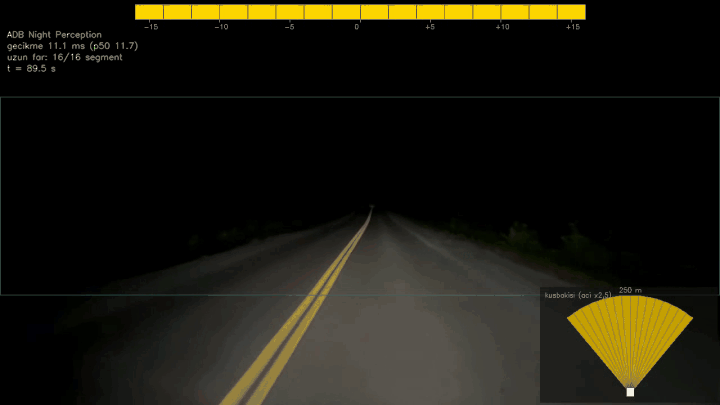
  <br><sub>Üstteki şerit far maskesi (sarı: uzun far açık, koyu: kısık), sağ alttaki yelpaze aynı kararın kuşbakışı görünümü. Görüntü: Pexels (video 15119004). Bu video modelin eğitim verisinden farklı bir kameradan; açılar yaklaşık.</sub>
</p>

## Bir bakışta

| | Sonuç | Hedef | |
|---|---|---|---|
| 220 m'de karşıdan gelen aracı yakalama (gece) | **%85** | %90 | ❌ yaklaştı: tam kare %75 → ufuk bandıyla %85 |
| Uçtan uca gecikme (p95) | **20,4 ms** | ≤ 50 ms | ✅ |
| İşlem hızı | **~60 FPS** (RTX 5050) | ≥ 25 FPS | ⚠️ gömülü cihazda ölçülmedi |
| Lambası yanan araçta kamaşma ihlali | **%0,8** (3 / 374) | ≤ %1 | ✅ küçük örnek: %95 aralık %0,3–2,3 |
| Far geometrisi kaynaklı kamaşma | **0** | | ✅ araç bulunduğunda doğru segment her seferinde kısıldı |
| Uzun far kullanımı | **%63** | ≥ %80 | ❌ kalıcı ışık kaynakları (sokak lambası, yansıma) gereksiz kısma yaptırıyor |
| Far titremesi (otoyol) | **5,0 / dk** | ≤ 2 / dk | ❌ bantın bedeli; bantsız 1,2. Küçük örnek: 1 olay = 1,25 / dk |

18 gereksinimden 8'i karşılandı, 4'ü kısmen, 4'ü karşılanmadı; 1'i ölçülemedi, 1'i uygulanmadı. Tamamı, ölçüm kaynaklarıyla: [docs/verification.md](docs/verification.md). Sonuçlar olduğu gibi, başarısızlıklar dahil raporlanıyor.

---

## İçindekiler
1. [Bu proje ne yapıyor?](#1-bu-proje-ne-yapıyor)
2. [Neden zor?](#2-neden-zor)
3. [Sistem nasıl çalışıyor?](#3-sistem-nasıl-çalışıyor)
4. [Veri](#4-veri)
5. [Model ve eğitim](#5-model-ve-eğitim)
6. [Geliştirme yolculuğu: 6 faz, 12 deney](#6-geliştirme-yolculuğu-6-faz-12-deney)
7. [Doğrulama ve risk analizi](#7-doğrulama-ve-risk-analizi)
8. [Bilinen sınırlamalar](#8-bilinen-sınırlamalar)
9. [Kurulum ve kullanım](#9-kurulum-ve-kullanım)
10. [Repo yapısı ve dokümanlar](#10-repo-yapısı-ve-dokümanlar)
11. [Lisans ve kaynaklar](#11-lisans-ve-kaynaklar)

---

## 1. Bu proje ne yapıyor?

Uzun far görüş mesafesini yaklaşık iki katına çıkarır, ama karşıdan gelen ve öndeki sürücüleri kamaştırdığı için çoğu zaman kapalıdır. **Adaptif uzun far (ADB)** farı LED segmentlerine böler: uzun far hep açık kalır, yalnızca diğer araçların bulunduğu dilimler karartılır.

<p align="center">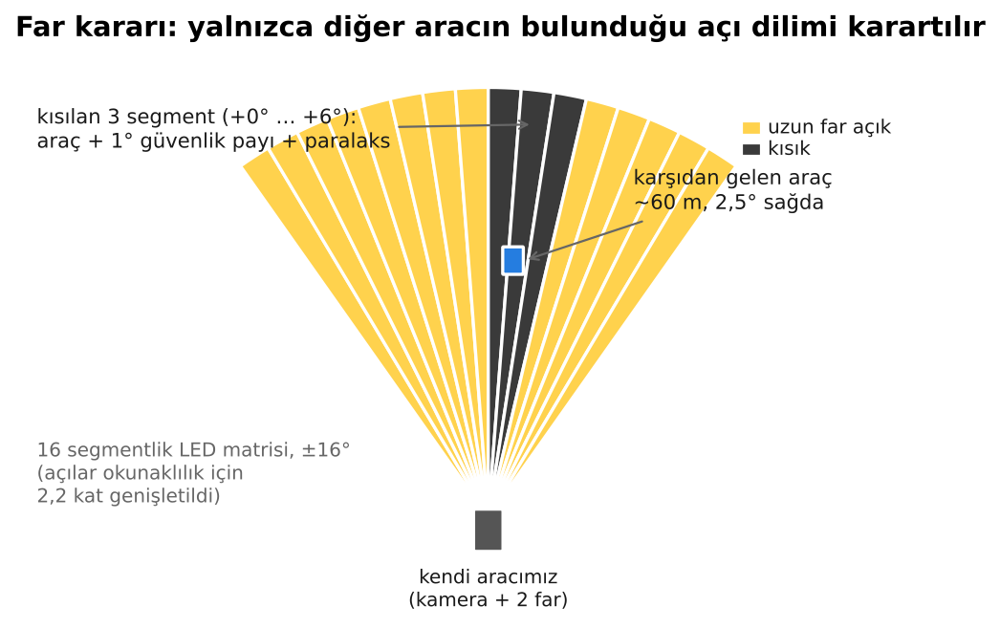</p>

Bu repo, işin **görme ve karar** kısmını yapıyor: kamera görüntüsünden hangi segmentlerin kısılacağına karar veren yazılım. Far donanımı ve LED sürücüsü kapsam dışı.

## 2. Neden zor?

Asıl zorluk mesafe. ABD'nin ADB kuralı (FMVSS 108) karşıdan gelen araçları **220 m**'ye kadar test ediyor. 60° görüş açılı, 1280 px genişliğinde bir kamerada o mesafede araç gövdesi gece görünmez; geriye **8 piksel aralıklı iki ışık noktası** kalır.

<p align="center">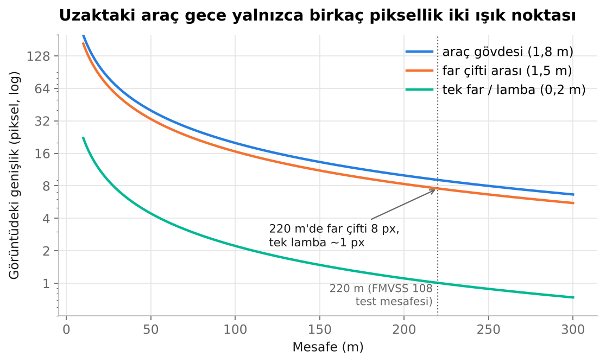</p>

Bu yüzden model araç gövdesinin yanında **farları ve arka lambaları da ayrı sınıflar** olarak algılıyor. İki zorluk daha var:
- **Hız:** karar, araç görüldükten sonra 200 ms içinde verilmeli; kamera 30 kare/sn.
- **Asimetrik hata:** açık bırakmak (karşıdakini kamaştırmak) kısmaktan çok daha kötü. Sistem şüphede kısa fara döner.

Hesaplar: [`scripts/pixel_budget.py`](scripts/pixel_budget.py) · gereksinimler: [docs/requirements.md](docs/requirements.md)

## 3. Sistem nasıl çalışıyor?

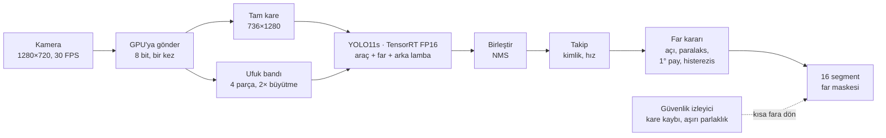

Her kare için sırasıyla:

1. **Algılama, iki geçişte.** Tam kare bir kez taranır. Ayrıca uzak araçların toplandığı **ufuk bandı** dört parçaya bölünür, iki kat büyütülür ve ayrıca taranır. 220 m'de recall'ı %75'ten %85'e çıkaran şey bu ([ADR-015](docs/decisions.md)).

   <p align="center">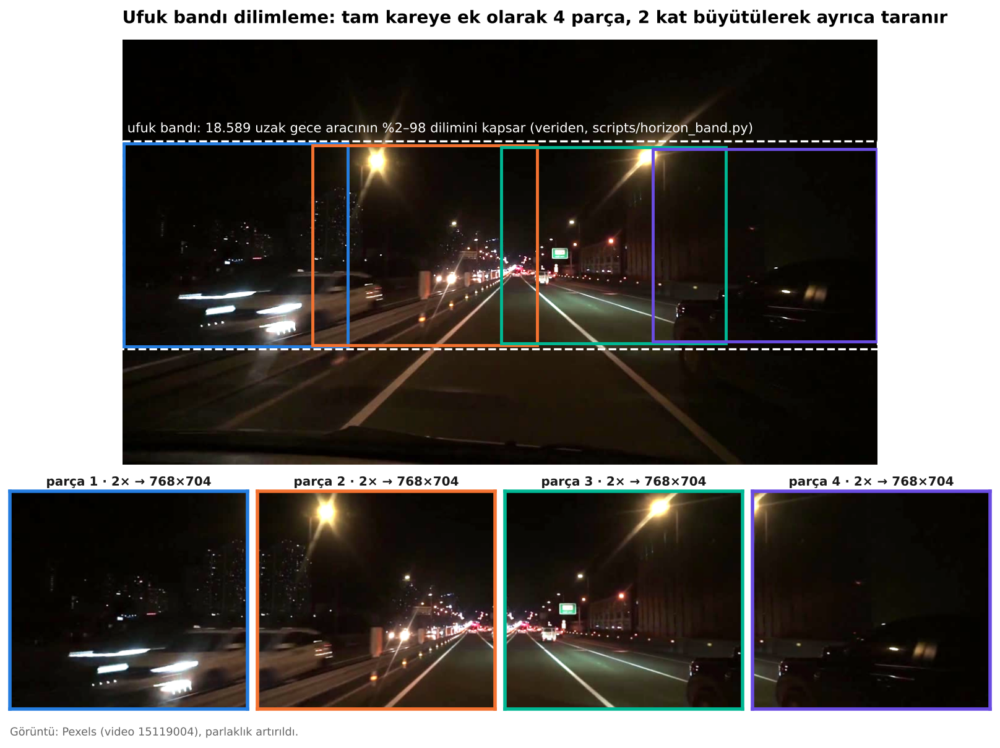</p>

2. **Takip** ([`adb/tracking.py`](adb/tracking.py)). Tespitler karelere göre eşlenir; tek karelik yansımalar elenir (iz, iki görüşte onaylanır). Uzak ve küçük nesneler için uyarlanmış ByteTrack mantığı.
3. **Geometri** ([`adb/geometry.py`](adb/geometry.py)). Piksel → açı. Kamera aracın ortasında, farlar 0,7 m yanda: yakındaki araçta bu **paralaks** 15 m'de 3,7° hata (~2 segment) demek, düzeltiliyor.
4. **Far kararı** ([`adb/decision.py`](adb/decision.py)). Aracın açı aralığına her yandan **1° güvenlik payı** eklenir, kesişen segmentler kısılır. Araç kaybolursa segment **1 sn** daha kısık kalır (histerezis): titremeyi önler.
5. **Güvenlik izleyici** ([`adb/safety.py`](adb/safety.py)). Kare 200 ms gelmezse ya da görüntü aşırı parlaksa tüm segmentler kısılır.

| Modül | Doğrulama |
|---|---|
| Algılama + ufuk bandı | Mesafe bazlı recall (Deney 1–2, 12), FP16 eşitliği (Deney 10) |
| Takip, geometri, far kararı | Birim testler + 68 gece videosunda sistem metrikleri (Deney 6–7) |
| Güvenlik izleyici | Hata enjeksiyonu testleri: kamera donması, aşırı pozlama ([`tests/test_requirements.py`](tests/test_requirements.py)) |
| Gerçek zamanlı hat | Aşama aşama gecikme ölçümü (Deney 9, 11, 12) |

## 4. Veri

**Kaynak:** [BDD100K](https://bdd-data.berkeley.edu/) tespit veri seti; zaman (gündüz / gece / alacakaranlık) ve hava etiketli 80.000 görüntü.

| Bölüm | Kaynak | Görüntü | Gece |
|---|---|---|---|
| train | BDD train %90 | 63.003 | %40 |
| val | BDD train %10 (koşul oranları korunarak) | 6.997 | %40 |
| test | BDD val | 10.000 | %39 |

**Bulgu: gece etiketlerinde uzak araçlar eksik.** Gece ve gündüz etiket yoğunluğu mesafeye göre karşılaştırıldığında, uzakta gece etiketleri gecenin doğal trafik oranının da çok altına düşüyor. Etiketsiz uzak araçlar eğitimde "arka plan" sayıldığı için model onları bastırmayı öğreniyor ([ADR-007](docs/decisions.md)).

<p align="center">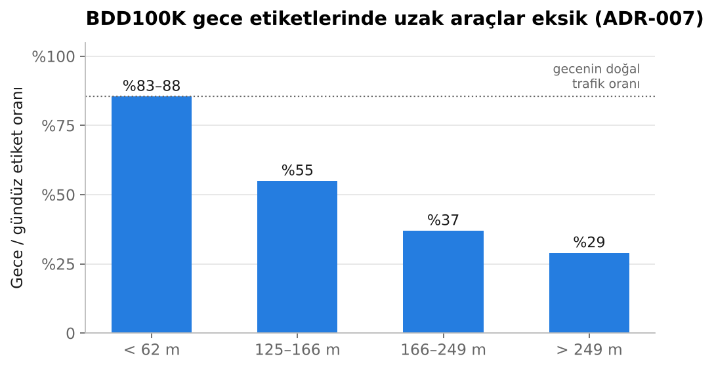</p>

**Far ve arka lamba etiketleri otomatik** ([`scripts/autolabel_lights.py`](scripts/autolabel_lights.py), [ADR-008](docs/decisions.md)). BDD'de ışık etiketi yok; elle nokta etiketleme kare başına 2–4 dakika sürdü (1.000 kare ≈ 30–60 saat). Bunun yerine:
1. Parlak ve çevresinden belirgin lekeler bulunur (parlaklık eşiği + top-hat filtresi).
2. Leke, **insanın çizdiği** bir araç kutusunun alt %75'indeyse o aracın ışığıdır: kırmızıysa `tail_light`, değilse `head_light`. Üst kısım hariç tutulur, ön cam yansımaları ışık sayılmaz.
3. Sonuç: ~29.000 gece/alacakaranlık karesinde kare başına ~17 ışık etiketi.

Otomatik sokak lambası etiketleri kare başına ~65 gürültülü kutu ürettiği için çıkarıldı ([ADR-009](docs/decisions.md)).

## 5. Model ve eğitim

| | |
|---|---|
| Model | YOLO11s (9,4 M parametre, 21,7 GFLOPs), COCO ön-eğitimli |
| Giriş | 1280 px (640'ta uzak ışıklar yarım piksele iniyor) |
| Sınıflar | car, truck, bus, motorcycle, bicycle, person, head_light, tail_light |
| Eğitim verisi | 25.000 kare: %75 gece, %10 alacakaranlık, %15 gündüz ([ADR-010](docs/decisions.md)) |
| Donanım | Kaggle 2× T4, 11 saat, batch 16, AMP |
| Dağıtım | TensorRT 10.16 FP16, iki sabit boyutlu motor (tam kare + bant), CUDA Graph |

| Koşul (test) | Görüntü | mAP50 | car | truck | motorcycle | person |
|---|---|---|---|---|---|---|
| Gündüz | 4.435 | 0,61 | 0,84 | 0,62 | 0,40 | 0,69 |
| **Gece** | 3.363 | 0,59 | **0,79** | 0,59 | 0,44 | 0,64 |
| Yağmurlu gece | 566 | 0,59 | 0,79 | 0,62 | 0,46 | 0,62 |
| Alacakaranlık | 648 | 0,62 | 0,84 | 0,62 | 0,41 | 0,65 |

Gece ile gündüz arasındaki fark yalnızca 1,6 puan: gece ağırlıklı eğitim listesi işe yaradı.

## 6. Geliştirme yolculuğu: 6 faz, 12 deney

Her deneyin ayrıntısı [docs/results.md](docs/results.md)'de, her kararın gerekçesi [docs/decisions.md](docs/decisions.md)'de (21 ADR), karşılaşılan sorunlar ve çözümleri [docs/devlog.md](docs/devlog.md)'de.

### Faz 0–2 · Kapsam, veri, temel model

Gereksinimler kimlik numaralarıyla yazıldı (REQ-F/P/S), veri hazırlandı, ışık etiketleri otomatik üretildi, temel model eğitildi. Koşul bazlı test, darboğazın her koşulda ~0,53 olan **recall** olduğunu gösterdi. Mesafe bazlı analiz kaçan araçların uzak araçlar olduğunu doğruladı: ışık sınıfları olmadan 220 m'de recall yalnızca 0,28, ışıklarla 0,75.

### Faz 3 · Uzak araçlar

Uzak araçları bulmak için dört yöntem denendi. Daha fazla etiket (sözde etiketleme), daha ince özellik haritası (P2 kafası) ve yalnızca büyütme işe yaramadı. Belirleyici olan, uzak bölgeye **ayrıca ve dar bir kadrajla** bakmaktı.

<p align="center">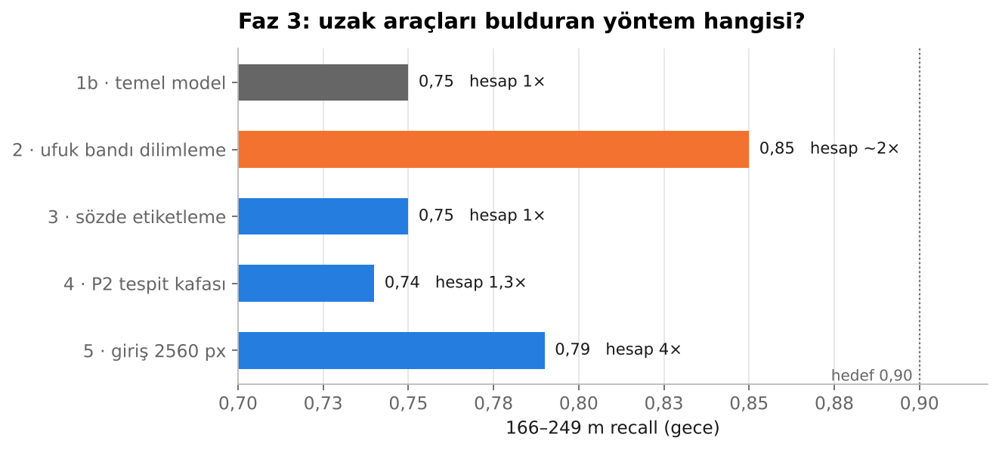</p>
<p align="center">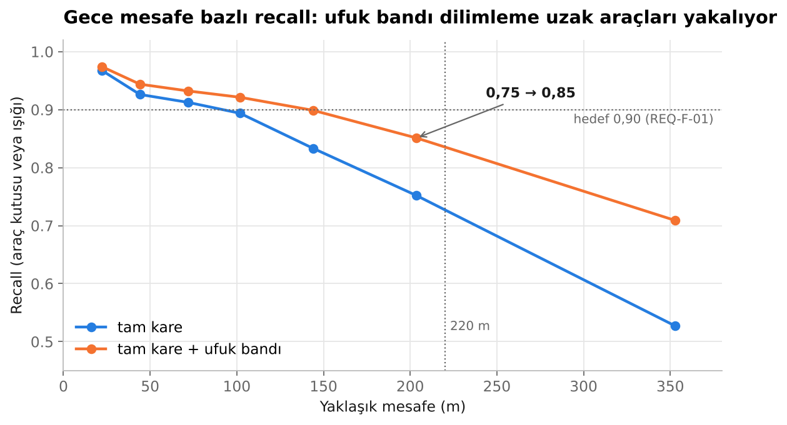</p>

### Faz 4 · Video üzerinde ADB sistemi

BDD100K'nın her etiketli görüntüsü kendi videosunun bir karesi. Test görüntülerinin videoları bulundu ve etiketli kare görüntü benzerliğiyle eşlendi (sızıntı yok: model bu videoları görmedi). Sistem burada ADB düzeyinde ölçüldü: karşıdaki araç kamaştırılıyor mu, uzun far ne kadar açık, far yanıp sönüyor mu?

| Otoyol + yerleşim, 20 gece videosu | Tam kare | Takip ile |
|---|---|---|
| Titreme / dk (hedef ≤ 2) | 3,8 | **1,2** ✅ |
| Uzun far kullanımı | %57 | **%65** |

**Kamaşma teşhisi** (68 gece videosu): far kapsamındaki her araç için ihlal varsa sebebi ayrıldı ve görseli çıkarıldı. Lambası yanan 374 araçta ihlal **%1,3**; bunların 4/5'i iki bozuk videodan (ıslak ön cam, kamera sarsıntısı). **Geometri kaynaklı ihlal sıfır.** Bozuk görüntüyü basit görüntü kalitesi ölçüleriyle yakalamak denendi, tutarlı ayıramadı; bulanıklık kontrolü bu yüzden kapalı ([ADR-018](docs/decisions.md)).

### Faz 5 · Gerçek zamanlılık

Model TensorRT FP16'ya çevrildi: tam kare ve bant için iki ayrı sabit boyutlu motor ([ADR-019](docs/decisions.md)). FP16 doğruluğu korudu (220 m recall 0,848 → 0,850, sistem metrikleri birebir aynı). Ama hat yine yavaştı: **darboğaz model değil, CPU'daki ön/son işlemeydi.** Bunlar GPU'ya taşınıp motorlar CUDA Graph ile çalıştırılınca gecikme dörtte birine indi ([ADR-021](docs/decisions.md)).

<p align="center">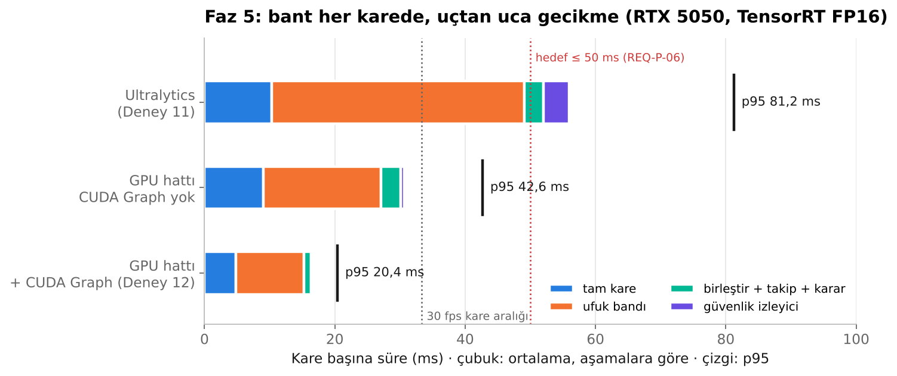</p>

Bu süreçte iki bulgu daha çıktı:
- Faz 3–4'teki gecikme dalgalanmasının kaynağı CPU'nun çekirdek başlatma süresiydi; CUDA Graph bunu kaldırdı (p99 8,8 → 2,8 ms).
- GPU hattı ilk ölçümde Ultralytics'ten %13 fazla kutu verdi. Adım adım karşılaştırma ([`eval/compare_backends.py`](eval/compare_backends.py)) farkı NMS eşiğinde buldu; düzeltilince çıktı birebir aynı.

C++ portu ve Jetson ölçümü gelecek çalışma olarak bırakıldı ([ADR-021](docs/decisions.md)).

### Faz 6 · Doğrulama, risk analizi, demo

Faz 4'ün sistem metrikleri bantsız ölçülmüştü; dağıtılan yapılandırma (bant her karede) yeniden ölçüldü (Deney 13). Ortaya bir ödünleşim çıktı:

| | Takip · tam kare | **Takip · tam kare + bant (dağıtılan)** | Hedef |
|---|---|---|---|
| Lambası yanan araçta kamaşma (68 video) | 5 / 374 (%1,3) | **3 / 374 (%0,8)** | ≤ %1 |
| Titreme / dk (20 video) | 1,25 | **5,0** | ≤ 2 |
| Uzun far kullanımı | %65 | **%63** | ≥ %80 |

Bant, Faz 4'te ıslak cam ve sarsıntılı videolarda kaçan iki aracı buldu; ama uzakta kısa süre görünüp kaybolan tespitler titremeyi artırdı. İki fark da küçük örneğe dayanıyor (2 araç; 3 titreme olayı). Gereksinimlerdeki asimetri gereği (kamaştırmak, gereksiz kısmadan daha ağır) **bant her karede kaldı** ([ADR-022](docs/decisions.md)); titreme 30 fps gerçek kayıtla yeniden ele alınmalı.

## 7. Doğrulama ve risk analizi

**Gereksinim doğrulama matrisi** ([docs/verification.md](docs/verification.md)), [`eval/verify_requirements.py`](eval/verify_requirements.py) ile otomatik üretiliyor: her gereksinim için hedef, ölçülen değer, durum ve kanıt (sonuç dosyası veya birim testi). Script ilgili testleri kendisi çalıştırıyor.

<p align="center">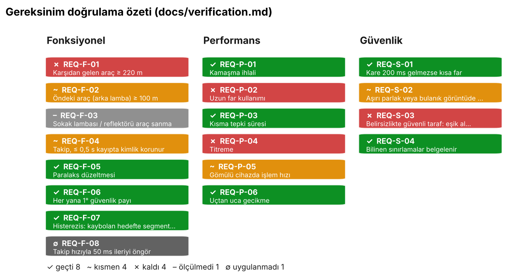</p>

Doğrulama iki eksiği de ortaya çıkardı ve ikisi de matriste açıkça yazıyor:
- **REQ-F-08** (takip hızıyla 50 ms öngörü) kodda hiç yok. Etkisi hesaplandı: yalnızca 30 m'nin altında, yanal hızlı geçen araçta 1° payı aşıyor.
- **REQ-S-03** (eşik altı tespitin bölgesini de kısmak) bilinçli olarak karşılanmıyor: düşük eşik yanlış kısmayı ve titremeyi artırdı ([ADR-017](docs/decisions.md)).

**FMEA** ([docs/fmea.md](docs/fmea.md)): 13 hata türü, şiddet × olasılık × tespit edilebilirlik. En yüksek riskler algılamada, karar mantığında değil:

| Risk | RPN | Durum |
|---|---|---|
| Bozuk görüntüde (ıslak cam, sarsıntı) araç kaçırılır | 288 | önlem yok; görüntü kalitesi sınıflandırıcısı veya yağmur sensörü sinyali gerekli |
| Kamera kalibrasyonu / montaj hatası | 256 | gerçek kamera yok; 1° pay kısmen karşılıyor |
| Uzak araç (166–249 m) kaçırılır | 240 | ufuk bandı ile %85; insan etiketli uzak araç verisi gerekli |

Riskleri destekleyen hata enjeksiyonu testleri: [`tests/test_requirements.py`](tests/test_requirements.py).

**Demo.** Sistemin farklı bir kameradan, sokak lambalı çok şeritli bir şehir otoyolundaki davranışı. Karşı şerit ve öndeki araçlar far kapsamının tamamını doldurduğu için maske çoğu karede tamamen kısık: bu yoğunlukta doğru davranış bu. Seçici karartma seyrek trafikli, aydınlatmasız yolda görünür.

<p align="center">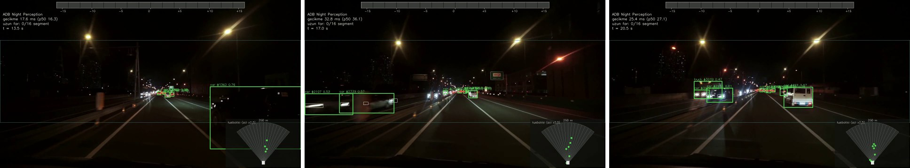</p>

Bu video modelin eğitim verisinden farklı (1080p, bilinmeyen görüş açısı, sokak lambalı yol); demo olarak yararlı, ama ölçüm sonucu buradan çıkarılmıyor. Demo üreticisi: [`scripts/render_demo.py`](scripts/render_demo.py).

## 8. Bilinen sınırlamalar

- **Gömülü cihazda ölçülmedi.** Gecikme RTX 5050 dizüstü GPU'sunda (prizde, en iyi performans modunda). Jetson'da motorlar ONNX'ten yeniden derlenmeli ([ADR-002](docs/decisions.md)).
- **Bozuk görüntü algılanmıyor.** Islak/kirli ön cam ve kamera sarsıntısı basit görüntü ölçüleriyle yakalanamadı; kamaşma ihlallerinin çoğu bu karelerden (Deney 8).
- **Işık sınıflarının gerçek doğruluğu ölçülmedi.** Doğrulama etiketleri de otomatik; raporlanan değerler modelin otomatik etiketleyiciyi ne kadar taklit ettiğini gösteriyor.
- **Mesafeler yaklaşık.** BDD100K'da mesafe etiketi yok; kutu genişliğinden, 60° görüş açısı varsayımıyla türetiliyor. Gerçek kamera kalibre edilmedi.
- **Video verisi 5 fps**, gerçek kamera 30 fps; her videoda tek etiketli kare. Takip parametreleri kare cinsinden ve 5 fps'e göre ayarlı.
- **Sistem metriklerinin örneği küçük.** Kamaşma 374 ışıklı araçta ölçüldü (1 araç ≈ 0,3 puan); titreme toplam ~0,8 dakikalık videoda (1 olay = 1,25 / dk).
- **Yanlış alarm ölçümü kötümser:** BDD'nin etiketlemediği uzak araçlar da yanlış alarm sayılıyor.
- **Uzak araç örneği küçük:** video setinde 125 m ötesinde 42 araç.

## 9. Kurulum ve kullanım

<details>
<summary><b>Kurulum</b></summary>

```powershell
python -m venv .venv
.venv\Scripts\activate          # Linux/macOS: source .venv/bin/activate
pip install torch torchvision --index-url https://download.pytorch.org/whl/cu128
pip install -r requirements.txt
python scripts/check_env.py      # GPU / CUDA / paket kontrolü
pytest -q                        # birim testler
```
TensorRT kurulumu (Windows, RTX 50 serisi): [deploy/README.md](deploy/README.md)
</details>

<details>
<summary><b>Veri hazırlığı ve eğitim</b></summary>

BDD100K'yı [resmi siteden](https://bdd-data.berkeley.edu/) indirip `data/raw/bdd100k/` altına aç (beklenen yapı: [data/README.md](data/README.md)).
```powershell
python scripts/bdd_prepare.py --bdd data/raw/bdd100k --out data/bdd_adb --copy-images   # YOLO formatı + koşul listeleri
python scripts/autolabel_lights.py                                                      # far/lamba etiketleri
python train/train_baseline.py                                                          # yerel eğitim
```
Kaggle'da eğitim: [`kaggle/adb_kaggle_train.ipynb`](kaggle/adb_kaggle_train.ipynb), adımlar [kaggle/README.md](kaggle/README.md). Çıktıyı içe aktarma: `python scripts/import_kaggle_output.py --eval`
</details>

<details>
<summary><b>Değerlendirme</b></summary>

```powershell
python eval/eval_conditions.py --weights runs/baseline/weights/best.pt                 # koşul bazlı mAP
python eval/eval_distance.py --weights runs/baseline/weights/best.pt --slice           # mesafe bazlı recall
python scripts/prepare_video_eval.py --frames data/bdd100k/images/track                # video değerlendirme verisi
python eval/eval_video.py --weights runs/baseline/weights/best.pt --scenes highway residential
python eval/diagnose_glare.py --weights runs/baseline/weights/best.pt                  # kamaşma ihlali sebepleri + görseller
```
</details>

<details>
<summary><b>TensorRT, gerçek zamanlı hat ve demo</b></summary>

```powershell
python deploy/export.py --val                     # FP16 motorlar: tam kare, bant, mAP için kare
$e = "--weights deploy/models/full_fp16.engine --band-weights deploy/models/band_fp16.engine --backend trt"
python eval/eval_distance.py $e.Split() --conds night --slice
python eval/bench_latency.py $e.Split()           # aşama aşama uçtan uca gecikme
python eval/verify_requirements.py                # doğrulama matrisi -> docs/verification.md
python scripts/render_demo.py --source video.mp4 --hfov 70
powershell -ExecutionPolicy Bypass -File scripts/faz6_final.ps1   # Faz 6'nın tamamı tek komutta
```
Şekiller: `python scripts/make_figures.py` (veri: [docs/data/](docs/data/)) ve `python scripts/make_readme_media.py`.
</details>

## 10. Repo yapısı ve dokümanlar

<details>
<summary><b>Repo yapısı</b></summary>

```
adb-night-perception/
├── adb/            geometri, ufuk bandı dilimleme, takip, far kararı, güvenlik izleyici, model yükleme, GPU hattı
├── configs/        system.yaml (kamera, far, eşikler, hedefler), classes.yaml, slicing.yaml
├── scripts/        veri hazırlama, otomatik etiketleme, analiz, demo ve şekiller
├── train/ kaggle/  yerel ve Kaggle eğitimi
├── eval/           koşul / mesafe / video değerlendirmesi, gecikme, doğrulama matrisi
├── deploy/         ONNX → TensorRT motorları, INT8 kalibrasyonu
├── docs/           gereksinimler, mimari, kararlar, sonuçlar, doğrulama, FMEA, şekiller (media/) ve verileri (data/)
├── tests/          birim, gereksinim ve hata enjeksiyonu testleri
└── data/           (repoda yok) veri setleri
```
</details>

| Doküman | İçerik |
|---|---|
| [requirements.md](docs/requirements.md) | Kimlik numaralı gereksinimler (REQ-F/P/S), piksel bütçesi, çalışma alanı (ODD) |
| [architecture.md](docs/architecture.md) | Modüller ve arayüzler |
| [decisions.md](docs/decisions.md) | 21 karar kaydı (ADR): bağlam, karar, sonuç |
| [results.md](docs/results.md) | Deney 1–12: tablolar ve gözlemler |
| [verification.md](docs/verification.md) | Gereksinim doğrulama matrisi |
| [fmea.md](docs/fmea.md) | Hata türleri ve etkileri analizi |
| [devlog.md](docs/devlog.md) | Geliştirme günlüğü: sorunlar, çözümler, çözülemeyenler |
| [literature.md](docs/literature.md) | SmartBeam, PVDN, 2PCNet, SAHI vb. ve projeye katkıları |
| [deploy/README.md](deploy/README.md) | TensorRT kurulumu, motorlar, gecikme ölçümü |

| Faz | İçerik | Durum |
|---|---|---|
| 0 | Kapsam, gereksinimler, altyapı | ✅ |
| 1 | Veri hazırlığı, otomatik far/lamba etiketleri | ✅ |
| 2 | Temel model, koşul ve mesafe bazlı değerlendirme | ✅ |
| 3 | Uzak araç: dilimleme ✅, sözde etiketleme ❌, P2 kafası ❌, giriş büyütme ⚠️ | ✅ |
| 4 | Takip, far kararı, video üzerinde sistem metrikleri, kamaşma teşhisi, güvenlik izleyici | ✅ |
| 5 | TensorRT FP16, doğruluk eşitliği, GPU'da ön/son işleme + CUDA Graph (p95 20 ms) | ✅ |
| 6 | Doğrulama matrisi, FMEA, hata enjeksiyonu testleri, demo | ✅ |
| Gelecek | C++ portu, Jetson ölçümü, REQ-F-08 öngörü, görüntü kalitesi sınıflandırıcısı, insan etiketli uzak araç seti | |

## 11. Lisans ve kaynaklar

Kod **AGPL-3.0** lisanslıdır ([LICENSE](LICENSE)); sebebi, kullanılan [Ultralytics YOLO](https://github.com/ultralytics/ultralytics) kütüphanesinin AGPL-3.0 olması ([ADR-004](docs/decisions.md)).

- **BDD100K:** görüntüler ve etiketler bu repoda **bulunmaz**; kullanım koşulları için [BDD100K lisansı](https://bdd-data.berkeley.edu/). README'deki şekiller yalnızca sayısal sonuçlardan üretildi.
- **Demo videosu:** [Pexels](https://www.pexels.com/video/15119004/) (video 15119004), Pexels lisansıyla.

---

Hazırlayan: **Efsun** · Bilgisayar Mühendisliği, Sakarya Uygulamalı Bilimler Üniversitesi
