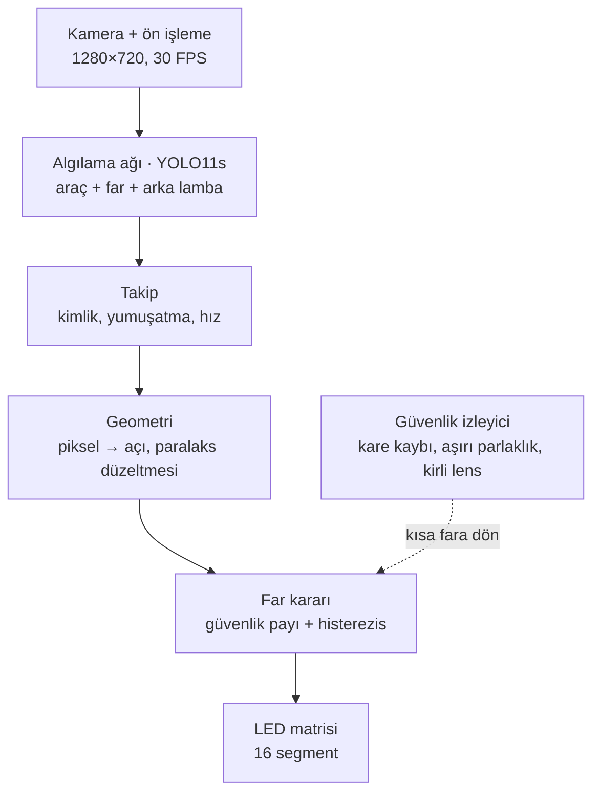

# ADB Night Perception

**Gece sürüşü için kamera tabanlı adaptif uzun far (ADB) algılama sistemi.** Tek ön kameradan araçları, farları ve arka lambaları algılar. Uzun farı açık tutarken yalnızca diğer yol kullanıcılarının bulunduğu açı dilimlerini karartacak 16 segmentlik bir far maskesi üretir. Hedef platform: gömülü cihaz (NVIDIA Jetson) üzerinde gerçek zamanlı çalışma.

> **Durum:** Faz 3 / 6. İlk model: araç sınıfında gece mAP50 **0,79**. Gece 220 m bandında araç veya ışığı **%75** oranında yakalanıyor (hedef %90). Sıradaki iş: uzak ışık tespitinin iyileştirilmesi. Ayrıntılar: [docs/results.md](docs/results.md)

---

## İçindekiler
1. [Problem](#problem)
2. [Sistem mimarisi](#sistem-mimarisi)
3. [Sonuçlar](#sonuçlar)
4. [Veri ve etiketleme](#veri-ve-etiketleme)
5. [Model ve eğitim](#model-ve-eğitim)
6. [Kurulum ve kullanım](#kurulum-ve-kullanım)
7. [Repo yapısı](#repo-yapısı)
8. [Mühendislik dokümanları](#mühendislik-dokümanları)
9. [Yol haritası](#yol-haritası)
10. [Bilinen sınırlamalar](#bilinen-sınırlamalar)
11. [Lisans](#lisans)

---

## Problem

Uzun far görüş mesafesini yaklaşık iki katına çıkarır, ama diğer sürücüleri kamaştırdığı için az kullanılır. ADB sistemi uzun farı açık tutar ve yalnızca diğer araçların bulunduğu dilimleri karartır. Bunun için sistemin araçları **çok uzaktan ve gece** fark etmesi gerekir.

Asıl zorluk mesafe. 60° görüş açılı, 1280 px genişliğinde bir kamerada:

| Mesafe | Far çifti arası (1,5 m) | Tek far/lamba (0,2 m) |
|---|---|---|
| 30 m | 55 px | 7 px |
| 100 m | 17 px | 2 px |
| **220 m** | **8 px** | **1 px** |

ABD'deki ADB kuralı (FMVSS 108) karşıdan gelen araçları 220 m'ye kadar test ediyor. Bu mesafede araç gövdesi gece görünmez, sadece **8 piksel aralıklı iki ışık noktası** kalır. Bu yüzden sistem araç gövdesinin yanında far ve arka lambaları da ayrı sınıflar olarak algılıyor. Hesap: [`scripts/pixel_budget.py`](scripts/pixel_budget.py), gerekçeler: [docs/requirements.md](docs/requirements.md).

## Sistem mimarisi



| Modül | Durum | Not |
|---|---|---|
| Algılama | ✅ eğitildi | YOLO11s, 1280 px, 10 sınıf |
| Geometri | ✅ kod + birim test | Paralaks düzeltmesi zorunlu: 15 m'de 3,7° hata (~2 segment) |
| Takip | ⏳ Faz 4 | ByteTrack |
| Far kararı, güvenlik izleyici | ⏳ Faz 4 | Parametreler [`configs/system.yaml`](configs/system.yaml) içinde |
| Gömülü dağıtım | ⏳ Faz 5 | ONNX → TensorRT (FP16/INT8), C++ |

## Sonuçlar

**Deney 1: Temel model.** Test seti: BDD100K val (10.000 görüntü), koşullara ayrılmış.

| Koşul | Görüntü | Precision | Recall | mAP50 | car | truck | motorcycle | person |
|---|---|---|---|---|---|---|---|---|
| Gündüz | 4.435 | 0,70 | 0,54 | 0,61 | 0,84 | 0,62 | 0,40 | 0,69 |
| **Gece** | 3.363 | 0,66 | 0,54 | 0,59 | **0,79** | 0,59 | 0,44 | 0,64 |
| Yağmurlu gece | 566 | 0,63 | 0,53 | 0,59 | 0,79 | 0,62 | 0,46 | 0,62 |
| Alacakaranlık | 648 | 0,77 | 0,53 | 0,62 | 0,84 | 0,62 | 0,41 | 0,65 |

**Hız:** RTX 5050 Laptop, FP16, 1280 px'te görüntü başına 6,5 ms çıkarım.

**Gözlemler:**
- **Gece–gündüz farkı küçük:** Genel mAP50'de 1,6 puan. Gece ağırlıklı eğitim listesi (ADR-010) işe yaradı.
- **Darboğaz recall:** Her koşulda ~0,53. Model gördüğünde çoğunlukla haklı, ama araçların yaklaşık yarısını kaçırıyor. Koşuldan bağımsız olması, kaçanların uzak/küçük araçlar olduğunu düşündürüyor. Mesafe bazlı analizle doğrulanacak.
- **Motosiklet en zayıf sınıf:** Eğitim verisinin sadece %0,35'i.

**Mesafe bazlı recall (gece, güven ≥ 0,10):** Işık sınıfları uzak mesafede belirleyici. 166–249 m'de (220 m hedefi) yalnızca araç kutusuyla recall **0,28**, araç kutusu veya far/arka lamba tespitiyle **0,75**.

| Mesafe | < 31 m | 62–83 m | 125–166 m | 166–249 m |
|---|---|---|---|---|
| Sadece araç kutusu | 0,93 | 0,75 | 0,54 | 0,28 |
| Araç kutusu veya ışığı | 0,97 | 0,91 | 0,83 | **0,75** |

REQ-F-01 (220 m'de ≥ 0,90) için 15 puan eksik. Faz 3'ün odağı bu.

Tam tablolar, ışık sınıfı sonuçları ve sınırlamalar: [docs/results.md](docs/results.md)

## Veri ve etiketleme

**Kaynak:** [BDD100K](https://bdd-data.berkeley.edu/) tespit veri seti. 80.000 etiketli görüntü, zaman (gündüz/gece/alacakaranlık) ve hava etiketli.

| Bölüm | Kaynak | Görüntü | Gece |
|---|---|---|---|
| train | BDD train %90 | 63.003 | %40 |
| val | BDD train %10 (koşul oranları korunarak) | 6.997 | %40 |
| test | BDD val | 10.000 | %39 |

**Bulgu: BDD gece etiketlerinde uzak araçlar eksik.** Gece ve gündüz etiket yoğunluğu mesafeye göre karşılaştırıldığında ([`box_size_stats.py`](scripts/box_size_stats.py)):

| Mesafe (yaklaşık) | < 62 m | 125–166 m | 166–249 m | > 249 m |
|---|---|---|---|---|
| Gece / gündüz etiket oranı | %83–88 | %55 | %37 | %29 |

Yakın mesafedeki ~%85, gecenin doğal trafik oranı. Uzakta etiketler bunun da altına düşüyor. Etiketsiz uzak araçlar eğitimde "arka plan" sayıldığı için model onları bastırmayı öğreniyor. ([ADR-007](docs/decisions.md))

**Otomatik far/lamba etiketleme** ([`autolabel_lights.py`](scripts/autolabel_lights.py), [ADR-008](docs/decisions.md)):
1. Parlak ve çevresinden belirgin lekeler bulunur (parlaklık eşiği + beyaz top-hat filtresi).
2. Leke, **insan tarafından çizilmiş** bir BDD araç kutusunun alt %75'indeyse o aracın ışığıdır. Kırmızı halka → `tail_light`, değilse → `head_light`. Üst kısım hariç tutulur, ön cam yansımaları ışık sayılmaz.
3. Sonuç: ~29.000 gece/alacakaranlık karesinde kare başına ~17 ışık etiketi, elle iş olmadan.

Elle nokta etiketleme denendi, kare başına 2–4 dakika sürdü (1.000 kare ≈ 30–60 saat). Otomatik yöntem bu yüzden seçildi. Otomatik `street_light` etiketleri kare başına ~65 gürültülü kutu ürettiği için çıkarıldı. Sokak lambaları eğitimde arka plan olarak kalıyor ([ADR-009](docs/decisions.md)).

## Model ve eğitim

| | |
|---|---|
| Model | YOLO11s (9,4 M parametre, 21,7 GFLOPs), COCO ön-eğitimli |
| Giriş | 1280 px (640'ta uzak ışıklar yarım piksele iniyor) |
| Sınıflar | car, truck, bus, motorcycle, bicycle, person, head_light, tail_light |
| Eğitim verisi | 25.000 kare: %75 gece, %10 alacakaranlık, %15 gündüz ([ADR-010](docs/decisions.md)) |
| Donanım | Kaggle 2× T4, 11 saat, batch 16, AMP |

İki eğitim yolu var:
- **Kaggle:** [`kaggle/adb_kaggle_train.ipynb`](kaggle/adb_kaggle_train.ipynb). Verileri kendisi bulur, salt okunur girdiyi yönetir, 12 saatlik oturuma sığar. Adımlar: [kaggle/README.md](kaggle/README.md)
- **Yerel:** [`train/train_baseline.py`](train/train_baseline.py). Ön kontrol (GPU, RAM, Windows disk belleği), otomatik işçi sayısı ve uyku engeli içerir.

## Kurulum ve kullanım

### Kurulum
```powershell
python -m venv .venv
.venv\Scripts\activate          # Linux/macOS: source .venv/bin/activate
pip install torch torchvision --index-url https://download.pytorch.org/whl/cu128
pip install -r requirements.txt
python scripts/check_env.py      # GPU / CUDA / paket kontrolü
pytest -q                        # birim testler
```

### Veri hazırlığı
BDD100K'yı [resmi siteden](https://bdd-data.berkeley.edu/) indirip `data/raw/bdd100k/` altına aç (beklenen yapı: [data/README.md](data/README.md)).
```powershell
python scripts/bdd_prepare.py --bdd data/raw/bdd100k --out data/bdd_adb --copy-images   # YOLO formatı + koşul listeleri
python scripts/visualize_labels.py --split train --cond night                           # gözle kontrol
python scripts/autolabel_lights.py                                                      # far/lamba etiketleri
```

### Eğitim ve değerlendirme
```powershell
python train/train_baseline.py --check                                     # ön kontrol
python train/train_baseline.py                                             # 8 saatlik eğitim
python eval/eval_conditions.py --weights runs/baseline/weights/best.pt     # koşul bazlı test
```

## Repo yapısı

```
adb-night-perception/
├── adb/            geometri (piksel→açı, paralaks, segment maskesi); takip ve karar modülleri buraya gelecek
├── configs/        system.yaml (kamera, far, eşikler, hedefler), classes.yaml
├── scripts/        veri hazırlama, otomatik etiketleme, analiz ve yardımcı araçlar
├── train/          yerel eğitim
├── kaggle/         Kaggle notebook'u ve eğitim scripti
├── eval/           koşul bazlı değerlendirme
├── deploy/         ONNX / TensorRT / C++ (Faz 5)
├── docs/           gereksinimler, mimari, kararlar (ADR), literatür, sonuçlar
├── tests/          birim testler
└── data/           (repoda yok) veri setleri
```

## Mühendislik dokümanları

| Doküman | İçerik |
|---|---|
| [requirements.md](docs/requirements.md) | Kimlik numaralı gereksinimler (REQ-F/P/S), piksel bütçesi, çalışma alanı (ODD) |
| [architecture.md](docs/architecture.md) | Modüller, arayüzler, karşılaştırılacak algılama mimarileri |
| [decisions.md](docs/decisions.md) | 10 karar kaydı (ADR): bağlam, karar, sonuç |
| [literature.md](docs/literature.md) | SmartBeam, PVDN, 2PCNet, SAHI vb. ve projeye katkıları |
| [results.md](docs/results.md) | Deney sonuçları ve gözlemler |

## Yol haritası

| Faz | İçerik | Durum |
|---|---|---|
| 0 | Kapsam, gereksinimler, altyapı | ✅ |
| 1 | Veri hazırlığı, otomatik far/lamba etiketleri | ✅ |
| 2 | Temel model, koşul ve mesafe bazlı değerlendirme | ✅ |
| 3 | Uzak araç iyileştirmesi: ufuk bandı dilimleme (SAHI), sözde etiketleme, gece augmentasyonu | ⏳ |
| 4 | Takip (ByteTrack), far kararı, güvenlik izleyici, sistem metrikleri | ⏳ |
| 5 | ONNX → TensorRT (FP16/INT8), C++ çıkarım, gecikme ölçümü | ⏳ |
| 6 | Doğrulama, FMEA, demo videosu | ⏳ |

## Bilinen sınırlamalar

- **Işık sınıflarının gerçek doğruluğu ölçülmedi.** Doğrulama etiketleri de otomatik üretildiği için raporlanan değerler modelin otomatik etiketleyiciyi ne kadar taklit ettiğini gösteriyor. İnsan kontrollü ~150 karelik bir set planlandı.
- **Mesafeler yaklaşık.** BDD100K'da mesafe etiketi yok. Mesafe kutu genişliğinden, varsayılan kamera parametreleriyle (60° HFOV) türetiliyor.
- **Gömülü performans henüz ölçülmedi.** Jetson'da doğrulanana kadar FPS iddiası yapılmıyor ([ADR-002](docs/decisions.md)).
- **Reflektörler** (yansıyan tabelalar) otomatik etiketlenemiyor, model onları arka plan olarak öğreniyor.

## Lisans

Kod **AGPL-3.0** lisanslıdır ([LICENSE](LICENSE)). Sebebi, kullanılan [Ultralytics YOLO](https://github.com/ultralytics/ultralytics) kütüphanesinin AGPL-3.0 olması ([ADR-004](docs/decisions.md)).

BDD100K görüntüleri ve etiketleri bu repoda **bulunmaz**. Kullanım koşulları için [BDD100K lisansına](https://bdd-data.berkeley.edu/) bakın.

---

Hazırlayan: **Efsun** · Bilgisayar Mühendisliği, Sakarya Uygulamalı Bilimler Üniversitesi
