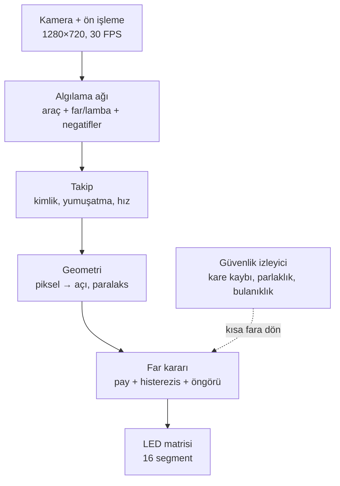

# Mimari

| Modül | Klasör | Girdi → Çıktı | Gereksinimler |
|---|---|---|---|
| Ön işleme | `adb/` | ham kare → normalize tensör + ufuk bandı kırpması | REQ-P-06 |
| Algılama | `train/`, `deploy/` | tensör → kutular (sınıf, güven) | REQ-F-01..03 |
| Takip | `adb/tracking.py` | kutular → takip edilen hedefler (id, hız) | REQ-F-04, F-08 |
| Geometri | `adb/geometry.py` | kutu → far açı aralığı | REQ-F-05 |
| Karar | `adb/decision.py` | açı aralıkları → segment maskesi | REQ-F-06, F-07, S-03 |
| Güvenlik izleyici | `adb/monitor.py` | kare istatistikleri → kısa far zorlaması | REQ-S-01, S-02 |
| Değerlendirme | `eval/` | maske dizisi + etiketler → metrikler | REQ-P-01..04 |

## Karşılaştırılacak algılama mimarileri (araştırma sorusu)

1. **YOLO (küçük boyut)**: uçtan uca, tam kare
2. **Hibrit (PVDN tarzı)**: klasik parlak leke adayı + küçük CNN sınıflandırıcı
3. **YOLO + ufuk bandı dilimleme (SAHI tarzı)**: tam kare + yüksek çözünürlüklü ufuk bandı

Üçü de aynı veride, aynı metriklerle ve Jetson üzerinde gecikmeyle birlikte karşılaştırılır.

## Tasarım ilkeleri

- Tüm sayısal parametreler `configs/system.yaml` dosyasındadır. Kodda sabit sayı bulunmaz.
- Geometri ve karar modülleri saf Python/C++ fonksiyonlarıdır ve birim testlerle doğrulanır. Modelden bağımsız test edilebilirler.
- Python referans uygulamasıdır. Gömülü çıkarım yolu (`deploy/cpp/`) aynı çıktıyı vermek zorundadır. İkisi aynı test videolarında karşılaştırılır.
